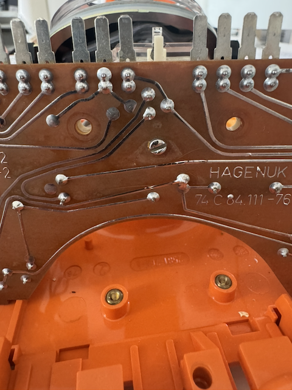
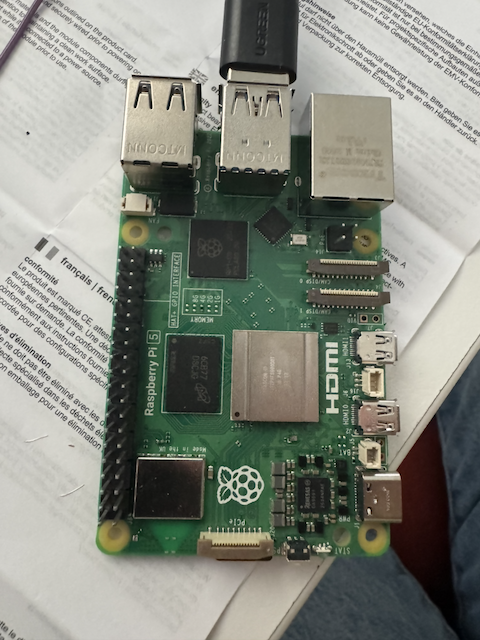
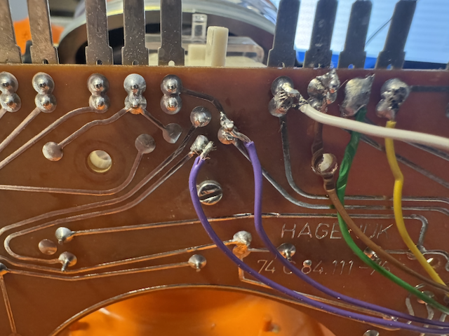
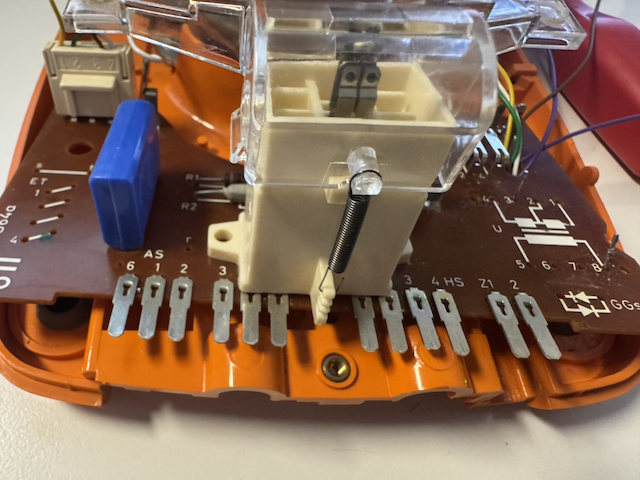
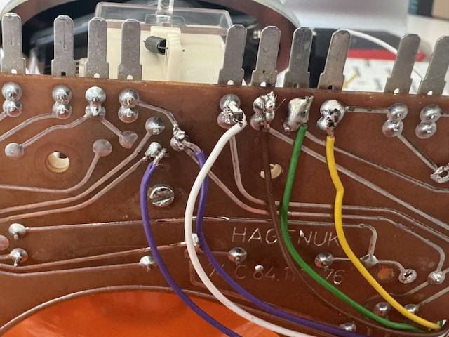

# KI-Telefon — Elektronik & Code: Lern-Dokument

Dieses Dokument erklärt, was wir im KI-Telefon-Projekt gebaut und programmiert
haben. Es richtet sich an alle, die mehr über Elektronik und Embedded-Software
lernen möchten — kein Vorwissen nötig.

---

## 1. Das Projekt auf einen Blick

Ein oranges Tischtelefon aus den 1970ern (FeTAp 611-2, Telekom) bekommt ein
neues Gehirn: ein Raspberry Pi 5 sitzt im Gehäuse, verbunden mit der originalen
Mechanik (Gabelschalter, Wählscheibe, Klingel, Hörer). Die ursprüngliche
Telefonelektronik wird größtenteils entfernt und durch den Pi ersetzt.

**Was passiert, wenn man den Hörer abhebt:**

1. Der Gabelschalter sendet ein Signal an GPIO 5 des Pi.
2. Das Programm spielt einen 425-Hz-Freizeichen-Ton (wie früher beim Wählen).
3. Man dreht die Wählscheibe auf eine Ziffer 1–9.
4. Das Programm wählt eine KI-Persönlichkeit (z.B. „Hein, hamburger Fischhändler").
5. Ein kurzes Freizeichen erklingt, während im Hintergrund die Verbindung zur
   OpenAI Realtime API aufgebaut wird.
6. Man kann normal sprechen — die KI antwortet direkt über die Hörkapsel.
7. Beim Auflegen wird die Verbindung getrennt.

---

## 2. Bauteile

| Bauteil | Funktion im Projekt |
|---|---|
| **FeTAp 611-2** (Telekom, orange) | Gehäuse + Mechanik: Gabelschalter, Wählscheibe, Klingelspule, Hörer |
| **Raspberry Pi 5** (4 GB) | Das Gehirn — läuft Python, steuert alle GPIOs, spricht mit OpenAI |
| **UGREEN USB-Soundkarte** | Mikrofon-Eingang (Sprechkapsel) und Lautsprecher-Ausgang (Hörkapsel) |
| **L298N H-Brücke** | Treiber-IC für die Klingelspule — liefert bipolare Wechselspannung |
| **Step-up-Wandler** (5 V → ~30 V) | Erhöht die Pi-Spannung auf die nötige Klingelspannnung |
| **Jumper-Kabel** (Dupont F-F) | Verbindung Pi-GPIO ↔ Telefonplatine |
| **Litze 0,14 mm²** | Dünne flexible Drähte für Lötstellen auf der Platine |
| **3,5-mm-Klinkenstecker** (×2) | Verbinden Hörkapsel + Sprechkapsel mit der USB-Soundkarte |
| **microSD-Karte** | Träger für das Raspberry Pi OS (Bookworm 64-bit) |

---

## 3. Das originale Telefon-Innenleben

### Schaltplan FeTAp 611 (vereinfacht)

Einen vereinfachten Schaltplan des FeAp 611 findet man auf Wikimedia Commons. Er liegt nicht im Repo, weil seine Lizenz nicht belegt ist.

Der Schaltplan zeigt alle Bauteile des originalen Telefons. Hier die wichtigsten
Bezeichnungen:

| Kürzel | Bedeutung | Was es tut |
|---|---|---|
| `F` | Fernhörer (Hörkapsel) | Lautsprecher im Handapparat |
| `M` | Mikrofon (Sprechkapsel) | Kohlemikrofon im Handapparat |
| `GU` | Gabelumschalter | Kontakt, der schließt wenn der Hörer abgehoben wird |
| `nsi` | Nummernschalter-Impuls | Gibt Impulse aus wenn die Wählscheibe zurückläuft |
| `nsa` | Nummernschalter-Anlass | Gibt Signal wenn die Wählscheibe gedreht wird (Anfang) |
| `W` | Wecker (Klingel) | Die originale elektromagnetische Klingelspule |
| `Ü` | Übertrager (Hagenuk-Trafo) | Transformator, der Mikro-/Hörsignal vom Amtsnetz trennt |
| `GGs` | Gleichrichter Gehörschutz | Schützt das Ohr vor zu hoher Spannung |
| `R1, R2` | Widerstände | Begrenzen Ströme im Hörer-Signalpfad |
| `C1, C2` | Kondensatoren | Sieben Gleichspannung aus dem Audiosignal |

### Was wir entfernt haben

Der Übertrager (Hagenuk-Block, grüner Trafo) und ein großer Kondensatorblock
wurden ausgebaut — sie gehören zur Amtsleitungs-Schnittstelle, die wir nicht
mehr brauchen. Das schafft Platz für den Pi im Gehäuse.

**Übrig geblieben:** R1, R2 und C1 — sie liegen im Signalpfad zwischen
Mikrofon/Hörkapsel und unseren Klinkenanschlüssen und verbessern die
Audio-Qualität.

### Foto: Platinen-Unterseite (vor dem Ausbau)



Man sieht die braune Platine von unten mit allen Lötstellen. Die Leiterbahnen
(Kupferlinien) verbinden die Bauteile. Der Hagenuk-Übertrager war oben links
montiert — nach dem Ausbau gibt es dort freien Raum für den Pi.

---

## 4. Verkabelung: Telefon → Raspberry Pi

### Übersicht

```
Telefon (FeTAp 611)          Raspberry Pi 5
─────────────────────        ──────────────────
GU-Kontakt (Gabel)  ──────── GPIO 5  (Pin 29)
GU-Kontakt (GND)    ──────── GND     (Pin 30)
nsi grün (Wählsch.) ──────── GPIO 26 (Pin 37)
nsi gelb (GND)      ──────── GND     (Pin 39)

Hörkapsel grün-gelb ──────── 3,5mm Klinke → USB-Soundkarte Headphone-Out
Sprechkapsel weiß-b ──────── 3,5mm Klinke → USB-Soundkarte Mic-In

H-Brücke IN1        ──────── GPIO 17 (Pin 11)
H-Brücke IN2        ──────── GPIO 27 (Pin 13)
H-Brücke ENA (PWM)  ──────── GPIO 22 (Pin 15)
H-Brücke +5V        ──────── 5V      (Pin 2)
H-Brücke GND        ──────── GND     (Pin 6)

Step-up OUT (+)     ──────── H-Brücke +12V-Eingang
Step-up OUT (-)     ──────── H-Brücke GND-Eingang
Klingelspule (W)    ──────── H-Brücke OUT1 + OUT2
```

### GPIO-Pinbelegung (Tabelle)

| Komponente | BCM-Pin | Pi-Stecker-Pin | Farbe/Anschluss |
|---|---|---|---|
| Gabelschalter | GPIO 5 | Pin 29 | blauer Draht von GU-Pad |
| Gabelschalter GND | GND | Pin 30 | blauer Draht, GND |
| Wählscheibe | GPIO 26 | Pin 37 | grünes Kabel (nsi) |
| Wählscheibe GND | GND | Pin 39 | gelbes Kabel (nsi) |
| H-Brücke IN1 | GPIO 17 | Pin 11 | Klingel-Richtung |
| H-Brücke IN2 | GPIO 27 | Pin 13 | Klingel-Richtung |
| H-Brücke ENA | GPIO 22 | Pin 15 | PWM-Steuerung |

> **Merkhilfe BCM vs. Stecker-Pin:** BCM ist die "offizielle" Chip-Nummer des
> GPIO-Controllers. Der "Pin 29" ist die physische Position am 40-poligen
> Stecker. Immer prüfen welches Nummerierungssystem gemeint ist —
> `gpiozero` benutzt standardmäßig BCM.

### Foto: Raspberry Pi 5 (GPIO-Orientierung)



Der 40-polige GPIO-Stecker ist oben links zu sehen (schwarze Pins). Pin 1
(3,3V) ist die Ecke ganz oben links. Der HDMI-Anschluss ist rechts, USB oben.

### Foto: Platine mit Drähten (finale Verkabelung)



Die blauen Drähte gehen zum Gabelschalter (GPIO 5). Die farbigen Drähte (grün,
gelb, braun, weiß) kommen von der Wählscheibe und dem Hörer. Wichtig: die
blauen Drähte müssen auf die **mittleren Pads** gelötet werden, nicht die Pads
ganz am Rand — diese sind intern permanent verbunden und sehen den
Schalter-Kontakt nicht.

### Foto: Gabelschalter-Mechanismus von oben



Der weiße Kunststoffblock mit dem Federkontakt ist der Gabelumschalter (GU).
Man sieht die Anschlussleiste (AS) mit den nummerierten Klemmen. Der
mechanische Stift drückt von unten auf den Federkontakt wenn der Hörer
aufliegt.

### Foto: Drähte mit Farb-Codierung



Die Drähte von der Wählscheibe: gelb (GND) und grün (Impuls-Signal). Die
anderen zwei Adern (braun, weiß) brauchen wir nicht und wurden abgeknipst.

### Hörer: Mikrofon + Lautsprecher

Die Hörkapsel (Lautsprecher, grün-gelb) und Sprechkapsel (Mikrofon, weiß-braun)
werden auf der **Unterseite** der Telefonplatine abgegriffen — der originale
Stecker des Handapparats bleibt intakt. Je ein 3,5-mm-Klinkenstecker wird
angelötet, die dann in die USB-Soundkarte gesteckt werden.

**Erfreuliche Entdeckung:** Das originale Kohlemikrofon des FeTAp 611
funktioniert direkt mit dem UGREEN-Mic-Eingang — kein Ersatz durch ein
Elektret-Mikrofon nötig. Der Mic-Eingang liefert genug Bias-Spannung über die
Spitze des Klinkensteckers.

### Klingel: H-Brücke + Step-up-Wandler

Die originale Klingelspule braucht ~30 V Wechselspannung. Der Pi liefert nur
5 V. Lösung in zwei Stufen:

1. **Step-up-Wandler:** 5 V vom Pi → ~30 V (über Trimm-Poti einstellbar)
2. **L298N H-Brücke:** Schaltet die 30 V abwechselnd in beide Richtungen durch
   die Klingelspule (bipolare Wechselspannung)

> **Wichtig:** Den Jumper auf der L298N-Platine entfernen, sonst wird die
> interne 5-V-Versorgung der Logik kurzgeschlossen. Wenn der Jumper raus ist,
> muss der +5V-Pin der H-Brücke separat vom Pi versorgt werden.

---

## 5. Elektronik-Konzepte erklärt

### Pull-Up-Widerstand

Ein GPIO-Pin am Pi hat keinen definierten Zustand wenn er mit nichts verbunden
ist — er „schwimmt" und kann zufällig HIGH oder LOW lesen. Ein
**Pull-Up-Widerstand** verbindet den Pin über einen Widerstand mit 3,3 V
(HIGH). Das ist der Ruhezustand.

Wenn dann ein Schalter (z.B. Gabelschalter) den Pin mit GND (0 V) verbindet,
zieht er den Pin aktiv auf LOW. So hat man einen klaren HIGH/LOW-Wechsel ohne
Rauschen.

```
3,3V ──[R]──┬── GPIO-Pin
             │
           [Schalter]
             │
            GND
```

Gpiozero aktiviert diesen internen Pull-Up mit `pull_up=True`:
```python
Button(5, pull_up=True)  # GPIO 5, interner Pull-Up aktiv
```

### Prellen (Contact Bounce)

Mechanische Schalter sind nicht perfekt: wenn der Kontakt schließt, „hüpft" er
mehrfach bevor er stabil ist. Das sieht für den Mikrocontroller aus wie viele
schnelle Ein/Aus-Wechsel innerhalb von Millisekunden.

**Beim Gabelschalter:** 5–10 schnelle Wechsel beim Auflegen/Abheben. Ohne
Entprellen würde das Programm denken, der Hörer wurde 5-mal in einer Sekunde
auf- und wieder aufgelegt.

**Lösung — `bounce_time`:**
```python
Button(5, pull_up=True, bounce_time=0.2)  # 200 ms Entprellzeit
```
Gpiozero ignoriert alle weiteren Signale für 200 ms nach dem ersten. Für die
Wählscheibe reichen 80 ms (echte Impulse liegen ~95–100 ms auseinander).

### PWM (Pulsweitenmodulation)

PWM ist eine Technik um eine analoge Spannung digital nachzubilden. Der Pi
schaltet einen Ausgang sehr schnell Ein und Aus. Das Verhältnis Ein/Aus
(Tastverhältnis / Duty Cycle) bestimmt die effektive Spannung.

```
100% (immer EIN):  ──────────────  = volle Spannung
 50% (halb):       ──  ──  ──  ──  = halbe Spannung
  0% (immer AUS):                  = keine Spannung
```

Für die Klingel läuft der ENA-Pin der H-Brücke mit 1000 Hz PWM und 50%
Tastverhältnis. So bekommt die Klingelspule die richtige Leistung.

### Bipolare Wechselspannung (für die Klingel)

Eine normale Klingelspule braucht **Wechselspannung** — Strom muss abwechselnd
in beide Richtungen fließen, damit der Hammer hin- und herschlägt (ca. 10 mal
pro Sekunde = 10 Hz).

Die H-Brücke macht das möglich:
- Phase 1: IN1=HIGH, IN2=LOW → Strom fließt vorwärts → Hammer schlägt nach links
- 50 ms Pause (Dead-Time: 3 ms Schutz vor Kurzschluss)
- Phase 2: IN1=LOW, IN2=HIGH → Strom fließt rückwärts → Hammer schlägt nach rechts
- Wiederholen mit 10 Hz → „Drrr-Drrr"-Klang

```python
# Bipolare Welle in scripts/test_bell.py
IN1.on()
IN2.off()
ENA.value = 0.5  # Vorwärts
time.sleep(0.05)  # 50 ms
IN1.off()
IN2.on()
ENA.value = 0.5  # Rückwärts
time.sleep(0.05)
```

### PCM16 Audio

**PCM** = Pulse Code Modulation — das Standard-Format für digitales Audio.

- **24.000 Hz Abtastrate:** 24.000 Mal pro Sekunde wird der Schallpegel gemessen
- **16 Bit:** Jede Messung hat 2^16 = 65.536 mögliche Werte (Auflösung)
- **Mono:** Ein Kanal (kein Stereo — ein Telefon braucht kein Stereo)

Dieses Format ist das native Format der OpenAI Realtime API — kein Umrechnen
(Resampling) nötig. Bei 24 kHz × 2 Bytes = 48.000 Bytes pro Sekunde Audio.

---

## 6. Was wir programmiert haben

Das Programm ist in **Python 3.11+** geschrieben, vollständig mit **asyncio**
(nicht-blockierende Event-Loop statt klassischer Threads). Es besteht aus mehreren
Modulen im Ordner `src/kitelefon/`.

### 6.1 Plattform-Abstraktion

Wir entwickeln auf dem Mac (Tastatur als Ersatz für Gabelschalter + Wählscheibe)
und deployen auf dem Pi. Damit derselbe Code auf beiden läuft, gibt es für jede
Hardware-Komponente ein **Protocol** (Interface) mit zwei Implementierungen:

```
Dialer (Protocol)
├── KeyboardDialer  → Mac: Tastendruck 1–9
└── GpioDialer      → Pi: GPIO 26, Impulszählung

HookSwitch (Protocol)
├── KeyboardHookSwitch  → Mac: Leertaste
└── GpioHookSwitch      → Pi: GPIO 5
```

Die Auswahl passiert über die Umgebungsvariable:
```bash
KITELEFON_PLATFORM=pi    # → GpioDialer + GpioHookSwitch
KITELEFON_PLATFORM=mac   # → KeyboardDialer + KeyboardHookSwitch (Standard)
```

### 6.2 Gabelschalter-Code (`hookswitch/gpio.py`)

```python
from gpiozero import Button
import asyncio


class GpioHookSwitch:
    def __init__(self, pin: int = 5, bounce_time: float = 0.2):
        self._button = Button(pin, pull_up=True, bounce_time=bounce_time)
        self._loop = asyncio.get_event_loop()
        self._queue: asyncio.Queue[HookEvent] = asyncio.Queue()
        self._button.when_pressed = self._on_pressed
        self._button.when_released = self._on_released

    def _on_pressed(self) -> None:
        self._loop.call_soon_threadsafe(self._queue.put_nowait, HookEvent.LIFTED)

    def _on_released(self) -> None:
        self._loop.call_soon_threadsafe(self._queue.put_nowait, HookEvent.HUNG_UP)

    async def events(self) -> AsyncIterator[HookEvent]:
        while True:
            yield await self._queue.get()
```

**Wichtige Details:**
- `when_pressed`/`when_released` sind Callbacks — gpiozero ruft sie in einem
  eigenen Thread auf, sobald GPIO 5 sich ändert.
- `call_soon_threadsafe` ist nötig weil asyncio nicht thread-sicher ist. So
  landet das Event sicher in der asyncio Event-Loop.
- `bounce_time=0.2` entprellt den mechanischen Kontakt (200 ms).

### 6.3 Wählscheiben-Code (`dialer/gpio.py`)

```python
MIN_PULSE_SEPARATION = 0.08  # 80 ms Mindestabstand zwischen Impulsen
INTER_DIGIT_TIMEOUT = 0.6  # 600 ms Stille = Ziffer abgeschlossen


class GpioDialer:
    def __init__(self, pin: int = 26):
        self._button = Button(pin, pull_up=True)
        self._pulses = 0
        self._last_pulse = 0.0
        self._button.when_pressed = self._on_pulse

    def _on_pulse(self) -> None:
        now = time.monotonic()
        if now - self._last_pulse < MIN_PULSE_SEPARATION:
            return  # Prellen ignorieren
        self._last_pulse = now
        self._pulses += 1
        self._loop.call_soon_threadsafe(self._reschedule_flush)

    def _reschedule_flush(self) -> None:
        if self._flush_handle:
            self._flush_handle.cancel()
        self._flush_handle = self._loop.call_later(INTER_DIGIT_TIMEOUT, self._flush)

    def _flush(self) -> None:
        digit = self._pulses if self._pulses < 10 else 0
        self._pulses = 0
        self._digit_queue.put_nowait(digit)

    async def read_digit(self, timeout: float) -> int | None:
        try:
            return await asyncio.wait_for(self._digit_queue.get(), timeout=timeout)
        except asyncio.TimeoutError:
            return None
```

**Ablauf beim Wählen der „5":**

```
Zeit →  [Impuls] [Impuls] [Impuls] [Impuls] [Impuls]     600 ms Stille
                 ↑ +1     ↑ +2     ↑ +3     ↑ +4     ↑ +5            ↓
                                                         Timer restart  _flush() → digit = 5
```

### 6.4 Klingel (`scripts/test_bell.py`)

```python
from gpiozero import OutputDevice, PWMOutputDevice

IN1 = OutputDevice(17)
IN2 = OutputDevice(27)
ENA = PWMOutputDevice(22, frequency=1000)  # 1 kHz PWM


def bipolar_wave(duration_s: float, freq_hz: float = 10) -> None:
    period = 1.0 / freq_hz  # 100 ms pro Zyklus
    half = period / 2.0  # 50 ms pro Richtung
    end = time.time() + duration_s
    while time.time() < end:
        ENA.value = 0
        time.sleep(0.003)  # 3 ms Dead-Time (Schutz vor Kurzschluss)
        IN1.on()
        IN2.off()
        ENA.value = 0.5  # 50% Tastverhältnis
        time.sleep(half)

        ENA.value = 0
        time.sleep(0.003)  # 3 ms Dead-Time
        IN1.off()
        IN2.on()
        ENA.value = 0.5
        time.sleep(half)
```

### 6.5 Audio-Pipeline (`audio.py`)

```
Mikrofon (Sprechkapsel)
    ↓
USB-Soundkarte (Hardware)
    ↓
sounddevice RawInputStream (Callback, PortAudio-Thread)
    ↓  call_soon_threadsafe
asyncio mic_queue (100ms Frames, 2400 Samples)
    ↓
WebSocket → OpenAI Realtime API (input_audio_buffer.append, base64)
```

```
OpenAI Realtime API (response.output_audio.delta)
    ↓
WebSocket empfangen → base64 dekodieren → PCM16 bytes
    ↓
playback_buffer (bytearray, Lock-geschützt)
    ↓  (wartet auf 12 KB = ~250 ms Jitter-Buffer)
sounddevice RawOutputStream (Callback, PortAudio-Thread)
    ↓
USB-Soundkarte → Hörkapsel (Lautsprecher)
```

**Warum der Jitter-Buffer?** Das Netzwerk liefert Audio-Pakete unregelmäßig.
Wenn man sofort mit der Wiedergabe beginnt, entstehen hörbare Aussetzer (Underruns).
Mit 250 ms Puffer hat das System Reserve und die Wiedergabe läuft flüssig.

**425 Hz Freizeichen:**
```python
# numpy generiert eine Sinus-Welle
step = 2 * np.pi * 425 / 24000  # Phasen-Schritt pro Sample
t = phase + step * np.arange(2400)
samples = (0.1 * np.sin(t) * 32767).astype(np.int16)
```

### 6.6 Zustand des Anrufs: State-Machine

Das Programm befindet sich immer in genau einem Zustand:

```
IDLE
  │  (Hörer abgehoben → HookEvent.LIFTED)
  ▼
DIALING
  │  Freizeichen 425 Hz spielt
  │  (Ziffer 1–9 gewählt, Timeout 5 s)
  ▼
RINGBACK
  │  Freizeichen-Melodie (1s Ton + 4s Pause × 2)
  │  Gleichzeitig: OpenAI WebSocket-Verbindung aufbauen (Pre-Warming)
  ▼
IN_CALL
  │  Mikrofon aktiv, Audio bidirektional
  │  KI kann Tools aufrufen (Spotify, Einkaufsliste, Rezepte…)
  │  (Hörer aufgelegt → HookEvent.HUNG_UP)
  ▼
TEARDOWN
  │  WebSocket schließen, Audio stoppen, Puffer leeren
  ▼
IDLE (wieder von vorn)
```

**Pre-Warming:** Die OpenAI-Verbindung wird schon während des Freizeichens
aufgebaut. So ist die KI bereit sobald das Freizeichen endet — ohne merkliche
Verzögerung für den Nutzer.

### 6.7 OpenAI Realtime API

Die Verbindung läuft über **WebSocket** (Protokoll für dauerhafte bidirektionale
Verbindungen). Kein HTTP-Request/Response — ein offener Kanal, über den
kontinuierlich Audiodaten fließen.

```
Pi                           OpenAI Server
 │──── WebSocket connect ───────────────→│
 │←─── session.created ─────────────────│
 │──── session.update (Rolle, Stimme) →│
 │←─── session.updated ─────────────────│
 │                                       │
 │──── input_audio_buffer.append ──────→│  (100ms Frames, base64-PCM)
 │←─── response.output_audio.delta ─────│  (KI-Antwort als PCM)
 │←─── [tool_call: spotify_play] ───────│  (wenn KI ein Tool aufruft)
 │──── [tool_result] ──────────────────→│
```

---

## 7. Diagnose-Scripts

Bevor man das vollständige Programm startet, kann man jede Komponente einzeln
testen:

```bash
# Gabelschalter testen — zeigt live "abgehoben"/"aufgelegt"
python3 scripts/test_gpio.py

# Wählscheibe testen — zeigt jeden Impuls und die erkannte Ziffer
python3 scripts/test_dial.py

# Klingel testen — schlägt zweimal an (Step-up-Wandler vorher auf Minimum!)
python3 scripts/test_bell.py

# Verfügbare Soundkarten auflisten (Index für asound.conf herausfinden)
python3 scripts/list_audio.py
```

**Goldener Test-Trick für den Gabelschalter (ohne Telefon):**
GPIO 5 (Pin 29) und GND (Pin 30) mit einem Draht brücken = simuliert
abgehobenen Hörer. Draht entfernen = aufgelegt.

---

## 8. Lessons Learned

Diese Lehrsätze haben wir beim Aufbau gelernt — jede davon durch einen echten
Fehler:

**1. Erst messen, dann tauschen**
Wir hätten fast das Kohlemikrofon durch ein Elektret ersetzt. Ein einfacher
Test mit einem Standard-Kopfhörer am Mic-Eingang hätte sofort gezeigt, dass
die Soundkarte funktioniert — das Mikro war in Ordnung.

**2. Eine kalte Lötstelle reicht**
Wenn ein Audio-Pfad komplett still ist, immer als erstes die letzte Lötstelle
prüfen. Nicht sofort im Treiber oder in der Software suchen. Bei uns war eine
Klinken-Lötstelle innen nicht richtig verbunden — neu verlöten = sofort Ton.

**3. PCB-Pads sind nicht der Schalter**
Benachbarte Pads auf einer Platine können über interne Leiterbahnen permanent
verbunden sein. Nur weil ein Pad neben dem Schalter liegt, heißt das nicht,
dass es den Schalter sieht. Den echten Schaltkontakt findet man mit dem
Durchgangsprüfer — den mechanischen Federarm direkt drücken und messen.

**4. `bounce_time` bei mechanischen Schaltern ist Pflicht**
80 ms für die Wählscheibe, 200 ms für den Gabelschalter. Ohne Entprellen
startet die State-Machine endlos neue Anrufe pro Sekunde.

**5. Plattform-Factories konsequent verwenden**
Direktimporte von `KeyboardDialer` in `__main__.py` haben das Platform-Switching
ausgekniffen — auf dem Pi wurde die Tastatur-Implementierung geladen statt GPIO.
Immer die Factory-Funktionen `make_dialer(platform)` benutzen.

**6. Log-Datei zusätzlich zur Konsole**
Auf dem Pi via SSH sieht man Logs nur solange der Vordergrund-Prozess läuft.
Eine Datei (`kitelefon.log`) ermöglicht `tail -f` und Post-mortem-Diagnose nach
einem Absturz.

---

## 9. Software-Abhängigkeiten

```toml
# pyproject.toml (Auszug)
dependencies = [
    "sounddevice>=0.4.6",    # Audio-I/O (Mic + Lautsprecher)
    "numpy>=1.26",            # Sinuston-Generierung (Freizeichen)
    "websockets>=12.0",       # WebSocket zur OpenAI Realtime API
    "pydantic>=2.5",          # Konfiguration + Daten-Validierung
    "pydantic-settings>=2.1", # .env-Datei laden
    "python-dotenv>=1.0",     # API-Keys aus .env
    "httpx>=0.27",            # HTTP für Mise-en-Place + Claude API
    "anthropic>=0.40",        # Claude SDK für Rezept-Generierung
]

# Nur auf dem Pi nötig:
[project.optional-dependencies]
pi = [
    "gpiozero>=2.0",   # GPIO-Abstraktion
    "lgpio>=0.2",      # Low-level GPIO Backend (Pi 5 / RP1-Chip)
]
```

**Warum `lgpio` statt `RPi.GPIO`?**
Der Raspberry Pi 5 hat einen neuen GPIO-Controller-Chip (RP1). Das ältere
`RPi.GPIO` unterstützt diesen nicht. `lgpio` ist der neue Standard und
funktioniert auf Pi 4 und Pi 5.

---

## 10. Erstes echtes Gespräch

Am 08.06.2026, 21:00 Uhr — nach der Bounce-Fix-Korrektur:

```
2026-06-08 21:02:14  hookswitch lifted
2026-06-08 21:02:14  call state: idle -> dialing
2026-06-08 21:02:18  digit received: 1
2026-06-08 21:02:18  selected role: Hamburger
2026-06-08 21:02:18  call state: dialing -> ringback
2026-06-08 21:02:24  call state: ringback -> in_call
```

> *„Moin moin, hier ist Hein…"*

Funktioniert.
